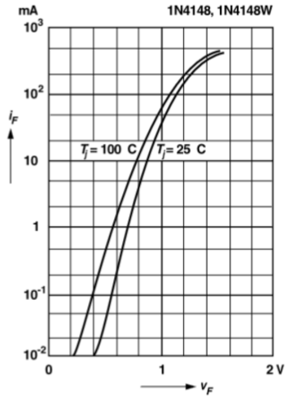

# ESP8266 Wmos D1 mini
Nutzung des ESP8266 da er vorhanden ist und genug Leistung mitbringt. 

* 24V -> 5V DC/DC Wandler
* ESP8266 
* 300k Widerstände
* Kleinsignaldiode  1N4148
[ESP8266 Datenblatt](https://documentation.espressif.com/0a-esp8266ex_datasheet_en.pdf)

Laut datenblatt ist die maximale Eingangspannung für ein Low-Signal am ESP 8266=0,25*Vio => 0,25 * 3,3V =  825mV
[Datenblatt Diode](https://cdn-reichelt.de/documents/datenblatt/A400/1N4148DO-35OLITECH.pdf)

 => Uf bei 0,1mA < 0,6V

Anschaltung der Sensoren über Kleinsignaldiode und 300k als Pullup, der Pullup muss groß gewählt werden um den Diodenstrom und damit die Diodenspannung zu senken um untern 
U-Low Max des MCU zu bleiben. 

Da Uf<UviomM -> Sensoren lösen aus

# Pin
LED des ESP8266 zeigt an:
* Blinken   -> Wlan wird verbunden
* Leuchtet  -> Übertragungsfehler beim Modbus (ist der Modbus Client an ?)
* Aus       -> Fehlerfreie Übertragung

Wenn mehr, weniger oder andere Pins übertragne werden sollen ist das in 
´´ḿain.cpp
int sensorPins[]={
  5,
  13,
  12,
  14,
  16};
  ´´´
  einzutragen.